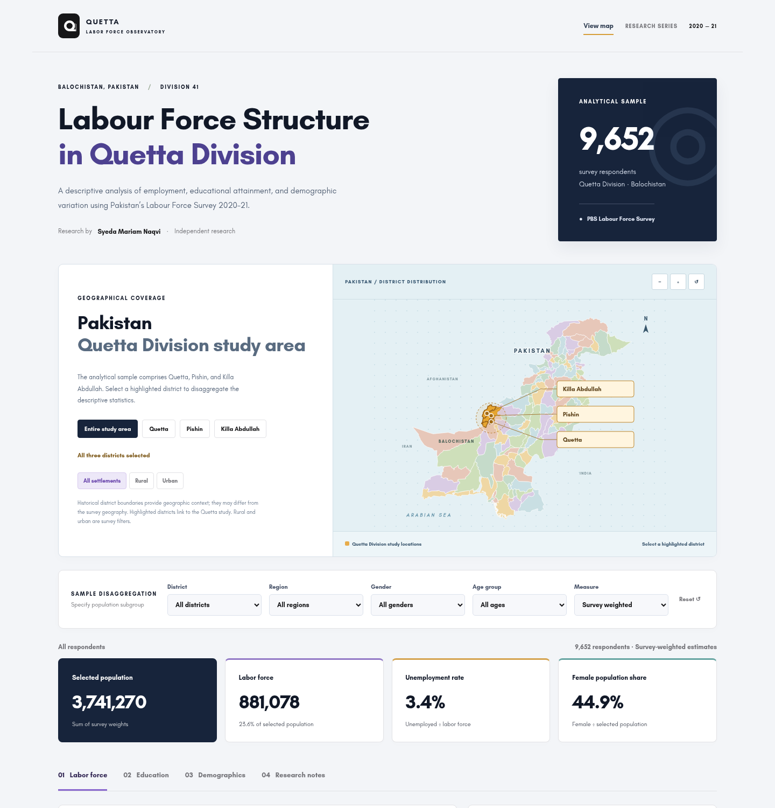
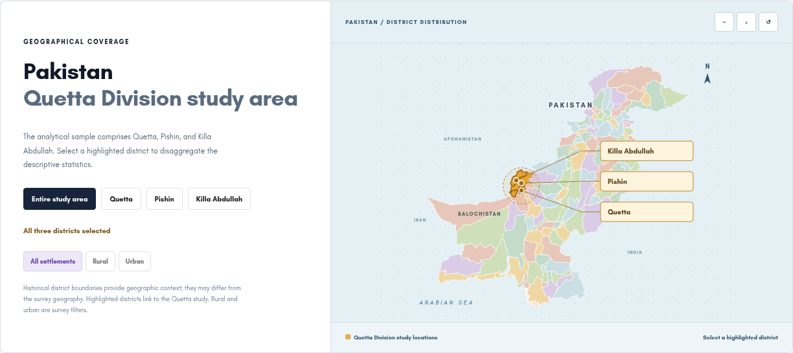
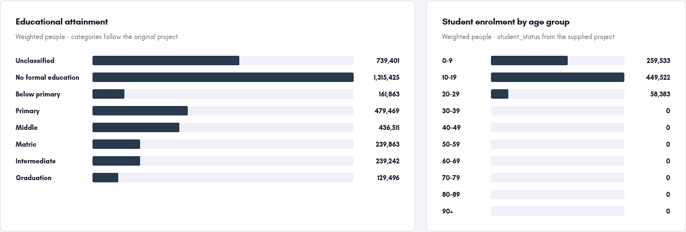
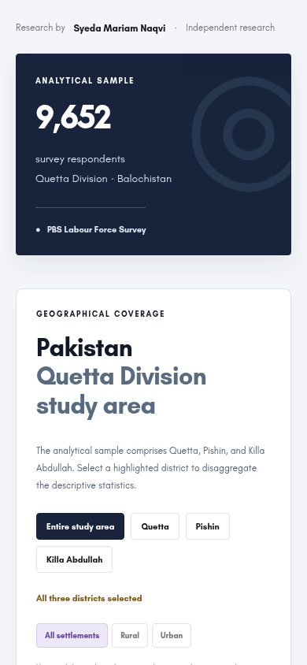
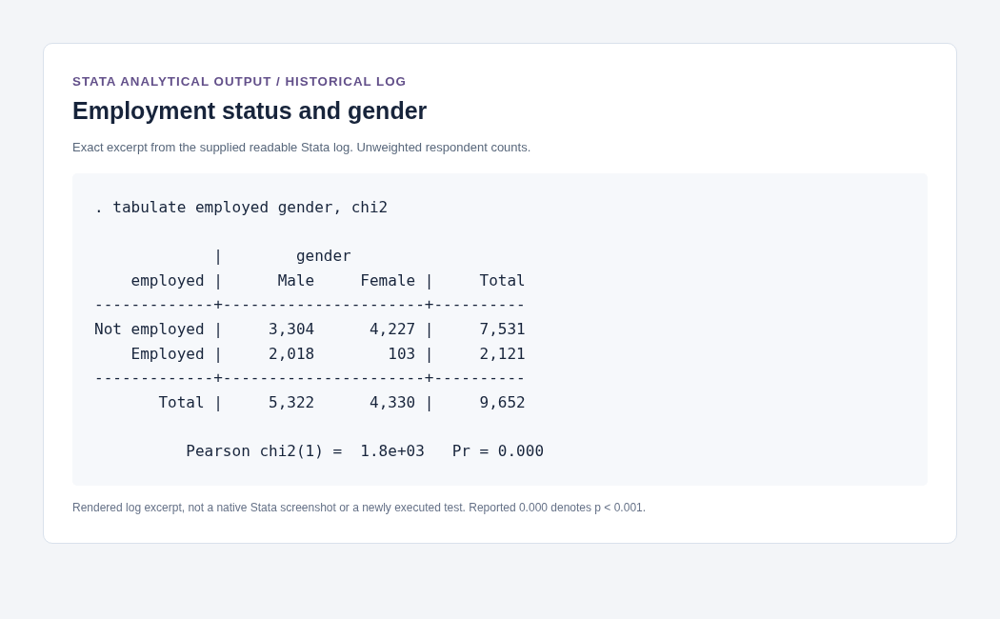

# Labour Force Structure in Quetta Division

**Syeda Mariam Naqvi** · Independent empirical research
**Pakistan Bureau of Statistics · Labour Force Survey 2020–21**

[**Explore the interactive dashboard ↗**](https://mariamnaqvi338-bot.github.io/quetta-stata-project-/) · [**Read the report**](research/report/quetta-labor-force-report.pdf) · [**View the Stata analysis**](research/stata/finalprojectmariam.do) · [**Read the analytical log**](research/stata/analysis-log.txt)



## Research overview

This study examines employment, educational attainment, and demographic variation in Quetta Division using Pakistan’s Labour Force Survey 2020–21. The analytical sample comprises **9,652 respondents** across **Quetta, Pishin, and Killa Abdullah** under the geography represented in the supplied extract. Weighted descriptive analysis is accompanied by unweighted chi-square tests and independent-samples t-tests documented in the historical Stata materials.

The research addresses three questions:

1. How are employment, unemployment, and labour-force participation distributed across age groups?
2. How do educational attainment and economic activity vary by gender and rural–urban settlement?
3. How are marital status, educational attainment, and employment associated within the observed sample?

**Methods and technical competencies:** microdata screening and management; variable construction; survey-weighted descriptive statistics; demographic disaggregation; statistical visualization; chi-square tests; independent-samples t-tests; Stata programming; and reproducible data presentation.

## Selected descriptive findings

The following estimates are recomputed from the current cleaned extract, rather than copied from the report’s narrative. Weighted estimates and sample counts are distinct.

| Indicator | Result | Interpretation |
| --- | ---: | --- |
| Analytical sample | 9,652 respondents | Unweighted number of survey records |
| Employed respondents | 2,121 | Unweighted count |
| Unemployed respondents | 98 | Unweighted count |
| Weighted labour force | 881,078 | Sum of weights for employed or unemployed respondents |
| Weighted unemployment rate | 3.44% | Weighted unemployed / weighted labour force |
| Ages 20–29: share of weighted employment | 31.1% | Share of all weighted employed people, not an age-specific employment rate |
| Ages 20–29: share of weighted unemployment | 60.8% | Share of all weighted unemployed people, not the youth unemployment rate |

These results describe a cross-sectional survey extract, not current population conditions or causal effects. The dashboard makes denominators explicit and preserves unclassified records.

## Interactive geographic coverage



The map links the three highlighted study districts to the dashboard’s filters. Users can combine district, settlement, gender, and age selections, switch between survey-weighted estimates and sample counts, and export filtered summaries. Historical district boundaries provide orientation and may differ from the survey or current administrative geography. Map colors distinguish areas; they do not encode statistical values.

## Educational attainment and demographic comparisons



Ten age groups span 0–9 through 90+. Education, marital status, economic activity, and student enrolment can be examined within selected subgroups. Employment and unemployment figures use explicit counts or shares, while indicator cards distinguish population-based participation from labour-force-based unemployment.

<details>
<summary><strong>Mobile dashboard preview</strong></summary>



</details>

## Stata analytical record

The [do-file](research/stata/finalprojectmariam.do) contains the supplied analytical commands. The [readable log](research/stata/analysis-log.txt) and [original SMCL log](research/stata/analysis.smcl) document historical output. These files provide more useful analytical evidence than screenshots of code alone.



*This is a rendered excerpt of the supplied log, not a native Stata interface screenshot or a newly executed test. Counts and tests in this excerpt are unweighted; reported p = 0.000 denotes p < 0.001.*

## Repository contents

| Material | File or directory |
| --- | --- |
| Interactive dashboard | [index.html](index.html), [app.js](app.js), [style.css](style.css) |
| Research report, without its cover page | [PDF](research/report/quetta-labor-force-report.pdf) · [Word](research/report/quetta-labor-force-report.docx) |
| Author-confirmed Stata do-file | [finalprojectmariam.do](research/stata/finalprojectmariam.do) |
| Supplied historical Stata output | [Readable text](research/stata/analysis-log.txt) · [SMCL](research/stata/analysis.smcl) |
| Portable descriptive Stata runner | [run-analysis.do](research/stata/run-analysis.do) |
| Latest cleaned Quetta dataset | [finalprojectmariam.dta](research/data/finalprojectmariam.dta) |
| Original national raw archive | [LFS2020-21_Microdata_STATA.zip](research/source/LFS2020-21_Microdata_STATA.zip) |
| Source inventory and checksums | [Source documentation](research/source/README.md) · [Metadata](research/source/metadata.json) |
| Analytical definitions and test scope | [METHODS.md](research/METHODS.md) |
| Supplementary recomputed figures | [PDF](research/figures/research-figures.pdf) · [PNG files](research/figures/) |
| Browser-ready aggregate cells | [quetta.json](data/quetta.json) |
| Preparation and verification utilities | [scripts/](scripts/) |
| Repository screenshots | [docs/screenshots/](docs/screenshots/) |

The report retains its original analytical body and adds redesigned supplementary figures. The cleaned binary dataset is unchanged. Introductory identifying comment lines unrelated to the analysis were omitted from the public Stata presentation; analytical commands were preserved.

## Data provenance and measurement

**Source:** Pakistan Bureau of Statistics, *Labour Force Survey 2020–21*. The original archive contains 570,991 records. Filtering `PCode` to prefix `41` yields the 9,652 Quetta respondents used here. All **165 original survey columns** and all selected records match the cleaned extract in order, ignoring storage-dtype differences.

The dashboard uses the latest author-supplied `finalprojectmariam.dta`. Its binary `student` indicator corresponds to `S4C10` codes 2–15. Gender and marital status are adapted in memory from `S4C5` and valid `S4C7` codes when derived names are absent. Education code `0` represents 1,845 unclassified entries; the historical do-file represents those entries as missing instead. Neither adaptation modifies the source dataset.

Weighted counts sum `Weights`; sample counts enumerate respondents. Labour force comprises employed or unemployed respondents. The unemployment rate divides unemployed by labour force. Participation divides labour force by the full selected population, including children when selected, so it is **not a conventional working-age participation rate**. The 3,143 respondents aged 0–9 are not classified as either in or outside the labour force by the supplied indicators; they remain explicitly unclassified.

The raw file embeds value labels for province, settlement, and gender only. Education labels reproduce the supplied analytical mapping and have not been independently verified against an official PBS codebook. The author’s analytical outline is documented in [METHODS.md](research/METHODS.md); it is not presented as the official coding scheme.

## Reproduce the descriptive workflow

### View the dashboard locally

From the repository root:

```sh
python -m http.server 8000 --directory .
```

Open `http://localhost:8000` on the same computer. The public dashboard requires no installation, backend, or API credentials.

### Regenerate aggregates and figures

```sh
python -m pip install -r requirements-data.txt
python scripts/prepare_data.py research/data/finalprojectmariam.dta
python scripts/render_figures.py
python -m unittest discover -s tests
node --check app.js
```

To verify raw-data provenance, extract the original ZIP outside the repository, then run:

```sh
python scripts/verify_raw.py /path/to/LFS2020-21.dta
```

The uncompressed national dataset is approximately 1.04 GB. Its unchanged compressed archive is retained in the repository; the uncompressed copy is not committed.

### Run the Stata companion

From the repository root in an installed Stata environment:

```stata
do research/stata/run-analysis.do
```

The portable runner adapts the cleaned file in memory and produces selected descriptive tables and tests. The author’s complete historical do-file starts from a Windows-specific raw-data path, which must be adapted before use. The historical log includes an initial missing-path error followed by analytical output; it is not evidence of a clean execution in a new environment. Stata is unavailable in the dashboard development environment, so these commands have not been independently rerun there.

### Refresh repository screenshots

With the local dashboard server running, install Playwright and a supported Chromium browser, then run:

```sh
python scripts/capture_screenshots.py http://localhost:8000
```

The capture utility renders actual dashboard views and an explicitly labeled excerpt from the supplied log. It does not simulate a Stata application window.

## Interpretation and limitations

- The findings refer to the 2020–21 extract and its survey geography. A year-wise employment/enrolment analysis is outside this study’s scope.
- The dashboard does not calculate complex-survey standard errors or confidence intervals. Small subgroups may yield unstable estimates.
- Reported hypothesis tests are unweighted historical results and do not update when dashboard filters change. Associations do not establish causal mechanisms.
- Raw and cleaned datasets contain respondent-level survey records and identifiers. They should not be described as anonymized. Consult PBS access and redistribution terms before further redistribution.

## Attribution and citation

**Research and analytical materials:** Syeda Mariam Naqvi.
**Survey:** Pakistan Bureau of Statistics, *Labour Force Survey 2020–21*.
**District geometry:** [Click That Hood Pakistan dataset](https://github.com/codeforgermany/click_that_hood/blob/main/public/data/pakistan.geojson), attributed there to DIVA-GIS; simplified for web presentation. A generalized Natural Earth-derived outline is retained from [johan/world.geo.json](https://github.com/johan/world.geo.json/blob/master/countries/PAK.geo.json).
**Typeface:** Glacial Indifference, locally bundled under the [SIL Open Font License](assets/fonts/OFL.txt).

To cite this repository, use [CITATION.cff](CITATION.cff) or GitHub’s **Cite this repository** feature.

© 2025 Syeda Mariam Naqvi. All rights reserved. This notice applies to original author materials; source data, geographic assets, and fonts remain subject to their respective terms. No general open-source license is granted by this repository.
